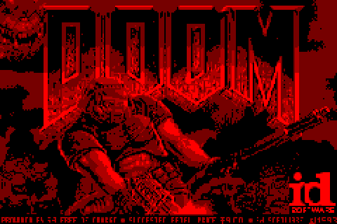
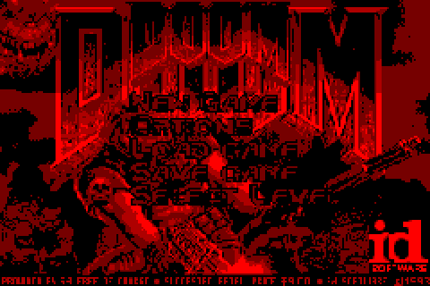
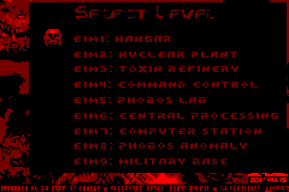
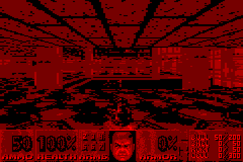
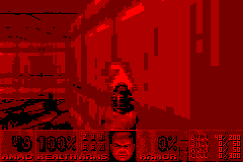
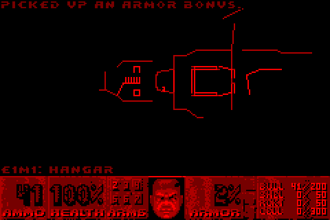
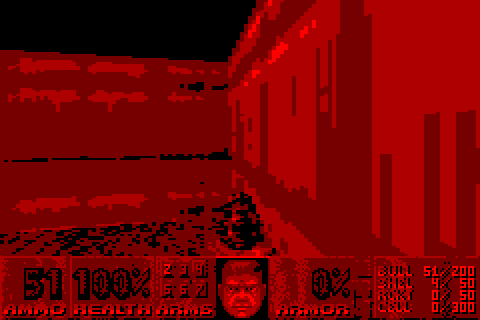
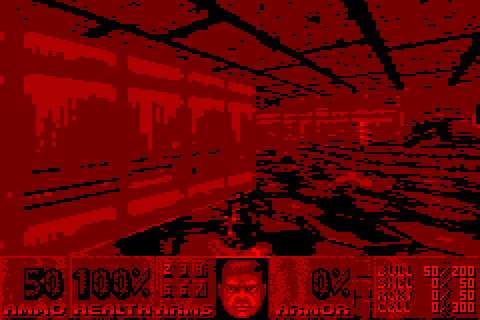

# DOOM for Virtual Boy

A port of the real Doom engine to the Nintendo Virtual Boy, built on 
[GBADoom](https://github.com/doomhack/GBADoom) (a prBoom derivative for the Game Boy Advance).
It runs the complete shareware Episode 1, *Knee-Deep in the Dead*, with music, sound effects and save games,
on an unmodified Virtual Boy with a HyperFlash32 flash cart.

> ## HEAVILY AI ASSISTED
> This port was **heavily AI assisted**. Most of the porting work, the Virtual Boy platform code,
> the renderer changes, the sound driver and the tools in this repository were written by an AI
> assistant
> The code builds and runs, and has been tested in Mednafen/Beetle VB and on a real Virtual Boy with
> a HyperFlash32. Even so, it has not had the line-by-line human review that hand-written homebrew
> normally gets. Please keep that in mind when you read, reuse or build on it.

 
 
 
 

*(Screenshots: one eye, scaled 2x. In the headset the image is red on black with 4 brightness levels.)*

## Features

- **The real Doom engine.** It isn't a raycaster remake: this is prBoom/GBADoom game logic and BSP renderer
  running natively on the NEC V810 CPU.
- **Episode 1, all 9 maps** (E1M1–E1M9), all monsters and weapons of the shareware game.
- **4-shade graphics** at 240×160 (3D view rendered at 120×128 and doubled horizontally), shown to both eyes.
- **Music**: the original Doom MUS scores, played on the Virtual Boy's VSU sound chip
  (4 melodic voices plus noise-channel percussion).
- **Sound effects**: Doom's original digitised effects, played as 4-bit PCM (two voices, stereo panned).
- **Save / Load**: 8 slots in the cartridge SRAM. As in GBADoom, a save stores the map, skill, weapons and ammo.
  Loading restarts that map with that equipment.
- **Level select** from the main menu (*Select Level*, drawn in Doom's own menu font).
- **Performance**: roughly 20–30 fps depending on the map (measured in Mednafen/Beetle VB).

## Download

Get `doom_vb.vb` from the [Releases](../../releases) page. The release also includes a HyperFlash32 eInk label
(`doom_vb.bwr`) and loading-bar icon (`doom_vb.icon`).

The ROM is 4 MB (32 Mbit) and needs no extra hardware. It has been tested on:

| Setup | Status |
|---|---|
| Real Virtual Boy + HyperFlash32 | Works, including saves |
| Mednafen / RetroArch Beetle VB | Works |

The ROM sets the cartridge ROM access to **1 wait state** (the Virtual Boy's WCR register) for extra speed. This works
on the HyperFlash32. If another flash cart shows crashes or garbage, build with `EXTRA=` (no `-DVB_ROM1WAIT`)
to get the standard 2 wait states.

## Controls

| Virtual Boy | Action |
|---|---|
| Left D-pad | Move / turn |
| Right D-pad left/right | Strafe |
| L or R trigger | Fire |
| A | Next weapon (select in menus) |
| B | Use / open doors (hold to run) |
| Start | Menu |
| Select | Automap |

## How it works (short version)

The Virtual Boy has **64 KB of RAM**. Even after GBADoom's many memory savings, Doom needs about 220 KB.

- **Memory.** The VIP's drawing hardware is switched off and the game writes straight into the frame buffers.
  That frees the character RAM, the BGMap/parameter DRAM and the OAM, about 160 KB of video memory, for general use.
  Doom's zone allocator was extended to spread across these non-contiguous regions plus spare WRAM.
  It uses region sentinels and best-fit allocation.
- **Rendering.** All drawers write directly into a 9.6 KB 2-bit-per-pixel buffer that already has the Virtual Boy
  frame-buffer layout. It is copied to the frame buffers once per frame. Wall and sprite columns are written
  4 pixels (one byte) at a time.
- **Smaller level data.** The mobj pool only reserves objects that actually spawn at the chosen skill,
  and the renderer limits were trimmed slightly.
- **Math.** FixedMul uses the V810's 64-bit `MUL`, and FixedDiv uses 32-bit hardware division plus 16 restoring
  steps. That removed GBADoom's 256 KB reciprocal table.
- **Sound.** A 5.5 kHz timer interrupt, written in assembly, mixes two PCM voices into VSU channel 5,
  which is used as a 4-bit DAC by rewriting its stereo level every sample. Every 1/140 s it runs the MUS
  sequencer. The MUS data is LZSS-compressed and decoded on the fly through a 4 KB window.
- **ROM space.** Unused lumps are stripped from the IWAD (demos, HELP1/HELP2, CREDIT, ENDOOM) to fit
  everything in 4 MB.

See `README_VB.md` (Spanish) and the comments in `vb/` for more detail.

## Building

You need the V810 GCC 4.7.4 toolchain, for example `linux/gcc` from
[VUEngine-Studio-Tools](https://github.com/VUEngine/VUEngine-Studio-Tools).

```sh
make TC=/path/to/v810/gcc/bin
# -> doom_vb.vb
```

The repository includes the pre-processed shareware IWAD (`source/iwad/doom1_vb.c`) and the generated audio data
(`vb/vb_audio_data.c`). To regenerate them you need `doom1.wad` (shareware v1.9) and Python 3 with numpy/scipy:

```sh
python3 audio/make_audio.py doom1.wad vb/vb_audio_data.c        # music + sound effects
python3 audio/build_iwad.py gba_doom1.wad vb_doom1.wad source/iwad/doom1_vb.c audio/M_LVLSEL.lmp
```

(`gba_doom1.wad` is the binary form of GBADoom's `source/iwad/doom1.c`.)

### Test tools

`tools/` contains a small Python libretro front-end around the Beetle VB core. It was used for automated testing:
it boots the ROM, drives the menus, warps through all 9 maps, records memory peaks, fps and audio,
and samples the CPU to find hotspots.

- Set `BEETLE_VB_CORE` to your `mednafen_vb_libretro.so`.
- Build `tools/noop.c` as `tools/noop.so` (`gcc -shared -fPIC -o tools/noop.so tools/noop.c`).
- The warp and profiling features need debug builds (`EXTRA="-DVBPROF -DVB_ROM1WAIT"`).

## Known limitations

- Shareware Episode 1 only (ROM size).
- No screen wipe ("melt") between screens, and no demo playback in the attract loop.
- The end-of-episode "order info" screen is replaced by the title picture.
- Music is limited to 4 simultaneous notes. Instruments are approximated with 5 waveforms.
- Sound effects are 4-bit/5.5 kHz and at most 2 play at the same time.
- Both eyes see the same image (no stereoscopic depth yet).

## Credits

- **id Software**: Doom, and the shareware game data.
- **doomhack**: [GBADoom](https://github.com/doomhack/GBADoom), the base of this port. Also the GBADoom contributors,
  including Kippykip.
- **The prBoom team**: the engine GBADoom is built on.
- **Chocolate Doom**: reference for Doom sound behaviour.
- **Mednafen / Beetle VB**: emulation used for development and automated testing.
- **VUEngine team**: the V810 GCC toolchain packaging (VUEngine-Studio-Tools).
- **Planet Virtual Boy community**: hardware documentation (Sacred Tech Scroll), libgccvb (crt0 and linker script)
  and the HyperFlash32 label and icon formats.
- **Port**: BrutalTurok, heavily assisted by AI (Claude, Anthropic).

## License

The code is released under the **GNU General Public License v2**, the same as prBoom and GBADoom. See `LICENSE`.

Doom and the Doom shareware data are © id Software. The shareware IWAD is included only in the
pre-processed form required to build the ROM, in the same way as GBADoom.
For the full game, please buy Doom.
